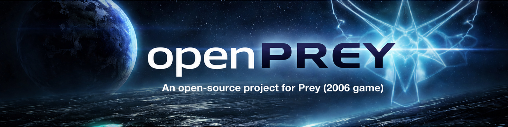

**The modern way to play PREY.** 
An open-source engine and game-code replacement that runs the original 2006 game on today's Windows and Linux PCs.

[Quick start](#quick-start) · [Features](#features) · [Platforms](#platforms-and-requirements) · [Guides](#player-guides) · [Help](#getting-help) · [Build from source](BUILDING.md)

## What is openPREY?

openPREY replaces PREY's engine and game binaries with its own: a GPL engine built on [openQ4](https://github.com/themuffinator/openQ4) and a source-available game module built from the PREY SDK. Your original campaign and multiplayer maps load from the retail game files, now with modern window and display handling, a choice of OpenGL or Vulkan rendering and one game module for single-player and multiplayer.

> [!NOTE]
> openPREY does **not** include any PREY game data. You need your own copy of PREY (2006), from the original discs or another legitimate source.

> [!IMPORTANT]
> openPREY is in **early development** and has no release yet. Representative campaign maps, save/load and a two-client multiplayer session have been played on it, but full campaign completion and multiplayer parity aren't claimed. See the [compatibility status](TECHNICAL.md#prey-compatibility-status).

## Quick start

Until the first release, you build openPREY yourself:

1. Install **PREY (2006)**. Leave it where it is; openPREY keeps to its own folder.
2. Build and stage openPREY with [BUILDING.md](BUILDING.md). The staged package lands in `.install/`.
3. Launch `openPREY-client_x64` (`.exe` on Windows) from `.install/`.
4. openPREY finds your PREY install on its own. If it doesn't, launch with `+set fs_basepath "C:\path\to\Prey"`, pointing at the folder that contains `base`, not at `base` itself.

> [!TIP]
> Don't copy retail `.pk4` files into `basepr/`. That folder is for openPREY's own files.

The [Releases page](https://github.com/themuffinator/openPREY/releases) still lists nightly builds from April 2026. They predate openPREY's move onto the current openQ4 engine and don't match this README.

## Features

What the current code does:

- 💿 **Finds CD-era installs.** openPREY checks the folder it starts in, the Windows registry (install keys, App Paths and uninstall entries) and the usual install folders such as `Human Head Studios\Prey` and `2K Games\Prey`. It doesn't depend on Steam or GOG. On Linux it looks in `~/Games/Prey`.
- ✅ **Checks your game files.** Startup confirms the official base packs are present. The consolidated retail layout is checksum-verified; CD-era numbered packs are checked for presence until their checksums are recorded.
- 🎮 **One module for every mode.** A single `game_x64` module, built from the PREY SDK, runs single-player and multiplayer.
- 🖥️ **Modern window handling** through SDL3: windowed, borderless, desktop fullscreen and exclusive fullscreen, monitor selection with `r_screen`, and aspect ratio and FOV that follow the render size. Linux runs native Wayland or X11.
- 🎨 **OpenGL or Vulkan.** OpenGL is the default and matches PREY's original interaction stages. The Vulkan renderer (`r_renderApi vulkan`) reaches gameplay in focused tests but isn't at full parity yet.
- 💡 **Baked light grids** add indirect light to portal areas: bake them, inspect them and switch them on. See [Light grids](TECHNICAL.md#light-grids).
- 🤖 **Multiplayer bots** (experimental): a cast of bot characters on PREY's own artificial player, each with a fighting style and chat. Retail maps ship no bot navigation, so bots fight what they can see and don't plan routes. See [the bot guide](docs/dev/mp-bots.md).
- 🧪 **Inherited from openQ4, not yet checked against PREY**: shadow maps, cel shading, DDS texture replacements, controller support with a Steam Deck profile, performance presets with Auto-Detect, and the level-load cache. Their guides are [below](#player-guides).

The [rebase status ledger](docs/dev/prey-rebase/status-ledger.md) records what has been ported and how each piece was tested.

## Platforms and requirements

| Platform | State | Notes |
|---|---|---|
| **Windows x64** | Built in CI; most runtime testing happens here | Windows 10/11 recommended |
| **Linux x64** | Built in CI | A modern 64-bit desktop, comparable to Ubuntu 24.04 or newer. SDL3 picks Wayland or X11; set `OPENPREY_FORCE_X11=1` to force XWayland |
| **Steam Deck** | Launcher in Linux builds | Run `openPREY-steamdeck`; inherited from openQ4, not yet checked with PREY. See the [Steam Deck guide](docs/user/steam-deck.md) |
| **macOS** | Not supported yet | The build files cover macOS hosts, but CI doesn't build or test it |
| **Windows and Linux ARM64** | Not supported yet | openQ4's ARM64 lanes are switched off until they're rebuilt for openPREY |

You'll need a 64-bit CPU, a graphics driver with OpenGL ARB2-era vertex and fragment program support, and PREY (2006)'s retail `base/` files.

## Player guides

These guides describe engine features carried over from openQ4. Each one says where PREY testing is still pending.

**Set up**
- [Getting Started](docs/user/getting-started.md): install layout, platform notes and [what to do if auto-detection fails](docs/user/getting-started.md#if-auto-detection-fails)
- [Client Settings](docs/user/client-settings.md): where the most useful options live
- [Display Settings](docs/user/display-settings.md) · [Input Settings](docs/user/input-settings.md) · [Gameplay Settings](docs/user/gameplay-settings.md) · [Steam Deck](docs/user/steam-deck.md)

**Look and feel**
- [Shadow Mapping](docs/user/shadow-mapping.md) · [Light Grids](docs/user/light-grids.md) · [Cel Shading](docs/user/cel-shading.md)
- [DDS Texture Replacements](docs/user/texture-replacements.md) · [Level-Load Cache](docs/user/level-load-cache.md)

**Host**
- [Server Setup](docs/user/server-setup.md) · [Multiplayer Networking](docs/user/multiplayer-networking.md)

## Compatibility

- openPREY runs the **official retail PREY (2006) assets** with its **own engine and game module**.
- Mods built for the original proprietary PREY game DLLs won't load.
- For multiplayer, use matching openPREY builds on every client and server.
- openPREY is in **early development**: compatibility work is ongoing.

## Getting help

- **Something broken?** Open an [issue](https://github.com/themuffinator/openPREY/issues) with your setup details and a log: launch with `+set logFile 2`, reproduce the problem and attach the `qconsole.log` it writes to your save folder.
- **Crashed on Windows?** Attach the log and minidump from the `crashes/` folder beside the executable.
- **Want to chat?** Find us on the [DarkMatter Discord](https://discord.gg/T32mFejwR4).

## For developers

- [BUILDING.md](BUILDING.md): build openPREY on Windows, Linux and macOS hosts
- [TECHNICAL.md](TECHNICAL.md): compatibility status, file layout, configuration and dependencies
- [AGENTS.md](AGENTS.md): project rules, including the licence boundary between engine and game code
- [Source layout](docs/dev/source-layout.md): where new code and vendored libraries go
- [The rebase plan](docs/dev/prey-rebase/plan.md): how openPREY moved onto openQ4 and adapts upstream engine changes
## Credits

**themuffinator** leads openPREY's development, with stewardship from **DarkMatter Productions**. openPREY stands on **Human Head Studios**' PREY and its SDK, and on the **[openQ4](https://github.com/themuffinator/openQ4)** engine, which brings the work of everyone credited there with it.

<b>Full credits and third-party software</b>

- **themuffinator**: openPREY development and maintenance; author of openQ4
- **DarkMatter Productions**: project stewardship and [website](https://www.darkmatter-quake.com)
- **Human Head Studios**: PREY (2006) and the PREY SDK that openPREY's game module is built from
- **[openQ4](https://github.com/themuffinator/openQ4)**: the engine openPREY is built on; its engine history is merged into this repository
- **[Emile Belanger (emileb)](https://github.com/emileb)**: original author of the Android port, SigmaTouch integration, OpenGL ES 3.0 renderer, GLES shader variants, ETC2/EAC compression and associated mobile work, carried into openPREY with the openQ4 engine; see [CONTRIBUTORS.md](CONTRIBUTORS.md) and the [integration record](docs/dev/android-gles-integration.md)
- **Justin Marshall**: Quake4Doom and early BSE reverse-engineering reference work
- **Daniel Gibson and the [dhewm3](https://github.com/dhewm/dhewm3) contributors**: cinematic JPEG handling inherited through Quake4Doom and openQ4, and the `dds/` texture-replacement naming convention openPREY follows
- **Robert Beckebans**: renderer modernization reference work, including RBDOOM-3-BFG inspiration
- **id Software's official Doom 3 and Doom 3 BFG source releases**: retained idTech 4 source lineage; see the [source-provenance inventory](docs/dev/source-provenance.md)
- **id Software** and **Raven Software**: idTech 4 and the Quake 4 codebase behind openQ4
- **[Ronald Rivest and RSA Data Security, Inc.](https://www.rfc-editor.org/rfc/rfc1320)**: the MD4 Message-Digest Algorithm behind the PK4 compatibility checksums; [notice](LICENSES/MD4.txt)
- **[The RmlUi Team, CodePoint, Shift Technology and contributors](https://github.com/mikke89/RmlUi/tree/6.3)**: MIT-licensed layout library behind the engine's retained interface; [licence notice](LICENSES/RmlUi.txt)
- **[Baptiste Lepilleur and the JsonCpp authors](https://github.com/open-source-parsers/jsoncpp/tree/1.9.8)**: JSON parser for the retained interface's source files, used under its MIT option; [licence notice](LICENSES/JsonCpp.txt)
- **[Mikko Mononen, Eric Veach and the libtess2 contributors](https://github.com/memononen/libtess2/tree/8dbd6483e920311a58c9af10a10beb278efebc36)**: SGI-B-2.0 polygon tessellator for the retained interface's vector shapes; [licence notice](LICENSES/libtess2.txt)
- **Sam Lantinga and the [SDL contributors](https://github.com/libsdl-org/SDL)**: cross-platform window, display and input support; SDL uses the zlib licence
- **Chris Robinson and the [OpenAL Soft](https://openal-soft.org/) contributors**: the OpenAL runtime bundled with Windows builds
- **[Xiph.Org Foundation](https://xiph.org/vorbis/)**: libogg and libvorbis audio codecs
- **Sean Barrett and the [stb_vorbis contributors](https://github.com/nothings/stb/blob/master/stb_vorbis.c)**: MIT/public-domain Vorbis decoding
- **The [GLEW](https://github.com/nigels-com/glew) team**: OpenGL extension loading
- **The Khronos Group and [glslang contributors](https://github.com/KhronosGroup/glslang/tree/16.6.0)**: GLSL-to-SPIR-V compiler used by the Vulkan renderer; [licence notice](LICENSES/glslang.txt)
- **[The Khronos Group, Valve Corporation and LunarG](https://github.com/KhronosGroup/OpenXR-SDK/tree/release-1.1.65)**: Apache-2.0 OpenXR loader and headers carried with the engine; [licence notice](LICENSES/openxr-sdk.txt)
- **[The Khronos Group](https://github.com/KhronosGroup/OpenGL-Registry)**: MIT-licensed OpenGL ES API headers, with their original notices retained; [licence notice](LICENSES/KHRONOS-GLES-MIT.txt)

## Licence

The openPREY engine is licensed under the [GNU General Public License v3.0](LICENSE). Files that keep Doom 3 or Doom 3 BFG Edition headers also keep their upstream notices and [Additional](LICENSES/DOOM-3-ADDITIONAL-TERMS.txt) [Terms](LICENSES/DOOM-3-BFG-ADDITIONAL-TERMS.txt); the [source-provenance inventory](docs/dev/source-provenance.md) records their scope and lineage.

The game code in [`src/game`](src/game/), [`src/Prey`](src/Prey/) and [`src/preyengine`](src/preyengine/) is derived from the PREY SDK and remains under [Human Head Studios' SDK EULA](LICENSES/PREY-SDK-EULA.rtf). [LICENSING.md](LICENSING.md) explains each component's terms, including the open question about distributing them linked together. PREY's game assets remain the property of their rights holders and are not included.

openPREY is an independent project and is not affiliated with, endorsed by or sponsored by Human Head Studios, 2K, Bethesda, ZeniMax Media, id Software or Raven Software. PREY is a trademark of ZeniMax Media Inc.

---

  <a href="https://www.darkmatter-quake.com">Website</a> · <a href="https://github.com/themuffinator/openPREY/releases">Releases</a> · <a href="https://github.com/themuffinator/openPREY/issues">Issues</a> · <a href="https://discord.gg/T32mFejwR4">Discord</a> · <a href="#top">Back to top</a>

